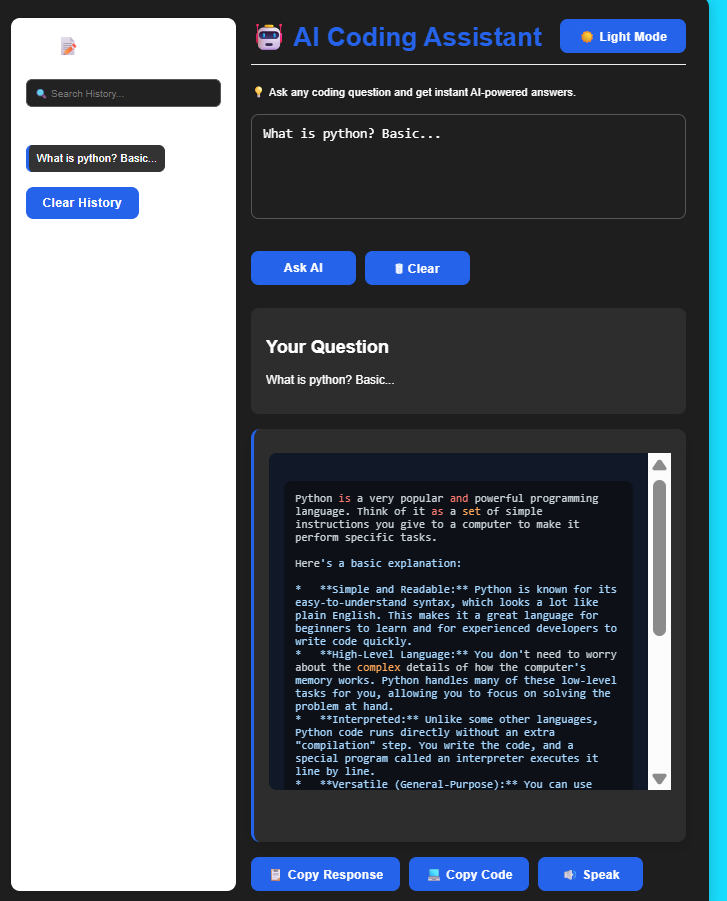

# AI Coding Assistant

A private, multi-user developer workspace built with Flask, SQLAlchemy, PostgreSQL/SQLite, and the Gemini API. Each account has isolated conversations, saved prompt templates, code snippets, settings, and analytics.

## Features

- Account registration, login, logout, and profile/password settings
- Password hashing, CSRF protection, secure production cookies, and authentication rate limits
- Per-user conversations and history stored in the database
- Generate, Explain, Debug, Optimize, and Convert modes backed by Gemini
- Searchable, editable, and deletable prompt templates, with starter templates for seven categories
- Saved code snippets
- User-specific analytics based on stored activity metadata (prompts and code are not displayed)
- Server-persisted theme and explanation preferences
- Responsive workspace, dark/light themes, response copy/download/speech controls
- CSRF-protected requests, sanitized Markdown output, and database migrations

## Local setup (Windows PowerShell)

1. Create and activate a virtual environment:

   ```powershell
   py -3.13 -m venv .venv
   .\.venv\Scripts\Activate.ps1
   ```

   You can use the existing `venv` instead if it is already set up.

2. Install dependencies:

   ```powershell
   python -m pip install -r requirements.txt
   ```

3. Create local configuration and set secrets:

   ```powershell
   if (-not (Test-Path .env)) { Copy-Item .env.example .env }
   ```

   This preserves an existing `.env`. Edit it only if needed and set `GEMINI_API_KEY`. Generate a local session secret with:

   ```powershell
   python -c "import secrets; print(secrets.token_hex(32))"
   ```

   Put the generated value in `SECRET_KEY`. Do not commit `.env`.

4. Create or update the database:

   ```powershell
   python -m flask --app app db upgrade
   ```

   By default this creates `instance/assistant.db`. For PostgreSQL, set `DATABASE_URL` to a PostgreSQL connection URL before running the migration.

5. Start the development server:

   ```powershell
   python app.py
   ```

6. Open <http://127.0.0.1:5000> and register an account.

The app starts without a Gemini key, but AI requests require a valid `GEMINI_API_KEY` (or `GOOGLE_API_KEY`). Do not run submitted code on the server. Existing browser-local conversations are offered for import after login; import only if they belong to the account you are using. Imported messages remain in conversation history but are excluded from analytics because their original per-message timestamps are unavailable.

## Environment variables

| Variable | Required | Purpose |
| --- | --- | --- |
| `APP_ENV` | Production | Set to `production` to require secure configuration and HTTPS-only cookies. |
| `SECRET_KEY` | Yes in production | Long, randomly generated Flask session/CSRF signing key. |
| `DATABASE_URL` | Yes in production | Persistent database URL. PostgreSQL URLs are adapted to the `psycopg` driver. |
| `GEMINI_API_KEY` | For AI requests | Gemini API credential. `GOOGLE_API_KEY` is also recognized. |
| `REDIS_URL` | Optional | Shared Flask-Limiter storage for multi-worker deployments. Without it, rate limits use per-process memory storage. |
| `PORT` | Hosting platform | Port used by the Gunicorn configuration. |

Production mode refuses to start without a random `SECRET_KEY` of at least 32 characters and a non-SQLite `DATABASE_URL`. Do not use SQLite on an ephemeral hosting filesystem for production data.

## Database migrations

The initial migration is checked in under `migrations/`. Apply it with:

```powershell
python -m flask --app app db upgrade
```

After changing models, create and review a migration before deploying:

```powershell
python -m flask --app app db migrate -m "describe the schema change"
python -m flask --app app db upgrade
```

Back up persistent databases before applying schema changes.

## Automated tests

Run the backend/security/ownership tests:

```powershell
python -m unittest discover -s tests -v
```

The tests use an isolated SQLite database and a mocked Gemini client; they do not call the external Gemini service. JavaScript syntax can be checked with:

```powershell
node --check static\script.js
```

## Render deployment preparation (do not deploy yet)

The repository includes a root `Procfile`, `gunicorn.conf.py`, and `runtime.txt`. The start command applies migrations and then starts Gunicorn. No deployment has been performed.

For a future Render deployment:

1. Create a **Free Web Service** from the repository. Do not select a paid web-service plan.
2. Configure a separate persistent PostgreSQL database and copy its connection URL into the web service as `DATABASE_URL`. The web service filesystem is not a permanent database. Confirm the selected database's current price, free-tier availability, and retention limits in Render before creating it; this repository does not provision a database.
3. Set these environment variables in the Render dashboard:
   - `APP_ENV=production`
   - `SECRET_KEY` to a newly generated random value
   - `DATABASE_URL` to the PostgreSQL connection URL
   - `GEMINI_API_KEY` to the Gemini credential
   - Optionally `REDIS_URL` for rate limits shared between worker processes
4. Use the repository `Procfile` start command; the configured command is `flask --app app db upgrade && gunicorn app:app --config gunicorn.conf.py`.
5. Confirm the service health endpoint at `/health` after a deployment.

Never put credentials in the repository or deployment logs. No service is deployed by this project workflow.

## Manual browser checklist

- [ ] Register with valid details; verify invalid email, weak/mismatched password, and duplicate email messages.
- [ ] Log in with correct and incorrect credentials.
- [ ] Log out and verify protected workspace routes redirect to login.
- [ ] Confirm the workspace is private to the signed-in user.
- [ ] Create a new conversation and send a prompt.
- [ ] Reopen conversation history and verify messages persist after refresh.
- [ ] Rename and delete conversations; verify the confirmation prompt.
- [ ] Try Generate, Explain, Debug, Optimize, and Convert with a configured Gemini key.
- [ ] Check language selection, code input, response rendering, and loading/error states.
- [ ] Test Copy response, Copy code, Download, and Speak where the browser supports them.
- [ ] Save, copy, edit, and delete a code snippet.
- [ ] Search, create, use, edit, and delete prompt templates. Confirm Use Template fills the workspace but does not submit.
- [ ] Review analytics after activity; check the empty state on a new account and ensure no prompt/code text appears.
- [ ] Update profile, theme, explanation preference, and password.
- [ ] Switch dark/light theme and verify the preference persists after reload.
- [ ] Test narrow/mobile viewport layout and navigation.
- [ ] Test missing API key, invalid forms, expired login session, and network/API errors.

## Security notes

- Passwords use Werkzeug's scrypt password hashing and are never sent back to the browser.
- Login, registration, and logout are protected by CSRF; login and registration have rate limits.
- All private database lookups are scoped to the current user.
- Production cookies are `HttpOnly`, `SameSite=Lax`, and `Secure`; production requires a configured secret and persistent database.
- Gemini Markdown is sanitized before storage/rendering. User text and pasted code are rendered as text.
- Rate limiting falls back to in-memory storage if `REDIS_URL` is absent; configure shared storage when running multiple workers.
- Do not expose API keys, session secrets, password hashes, or user content in logs or source control.



## Future improvements

- Voice input support
- Additional AI models
- Mobile app version

## Author

**Maham Waseem**

Passionate about AI, Python, and software development.

GitHub: <https://github.com/Maham-coree>

LinkedIn: <https://www.linkedin.com/in/maham-waseem-89735134a>
